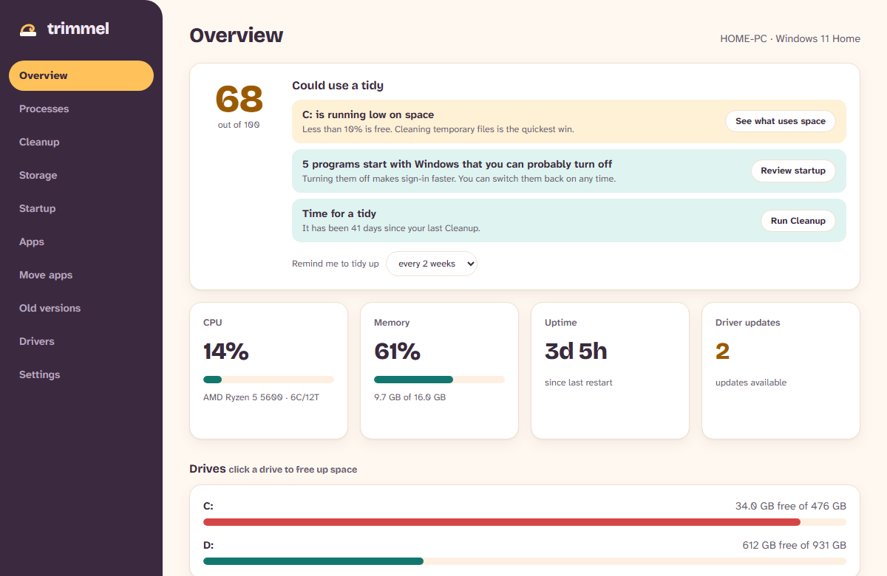
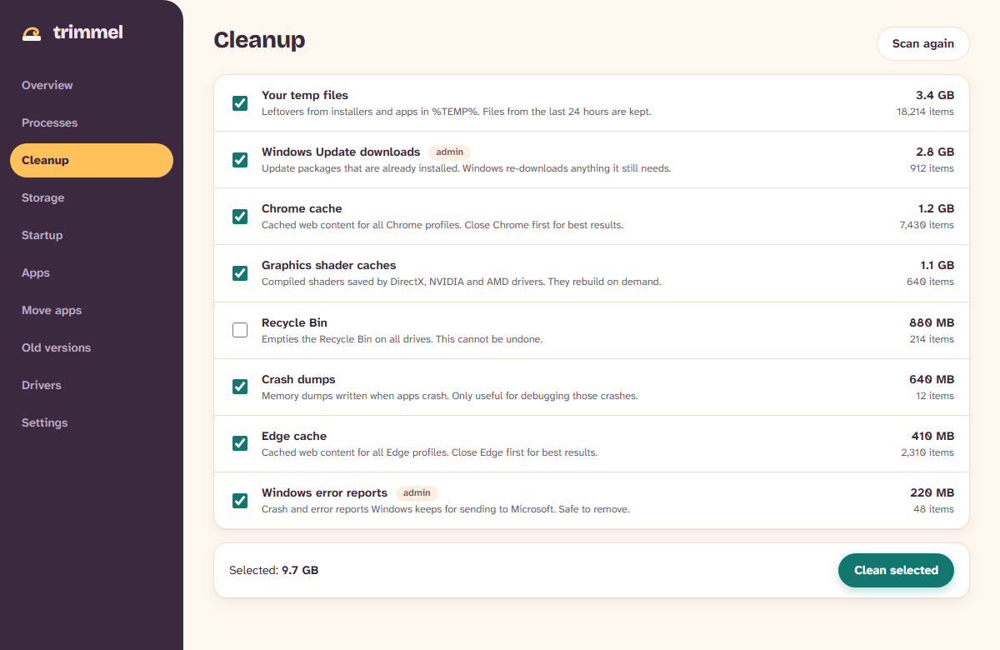
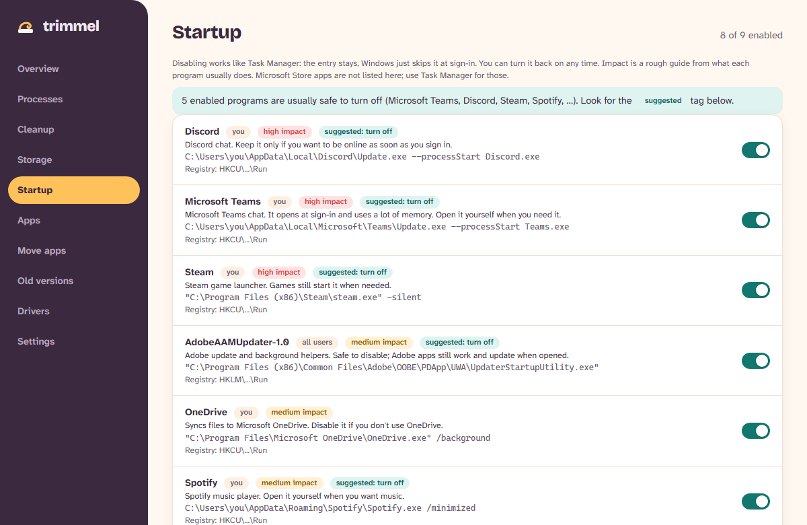
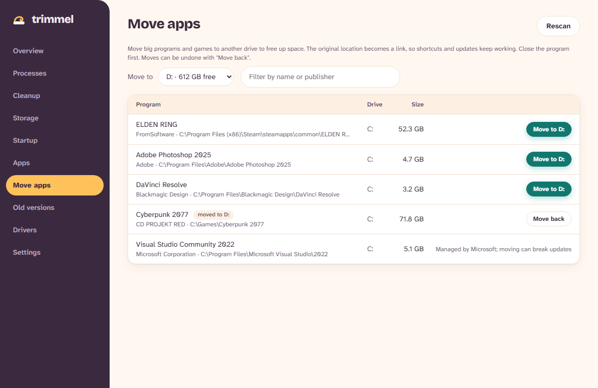
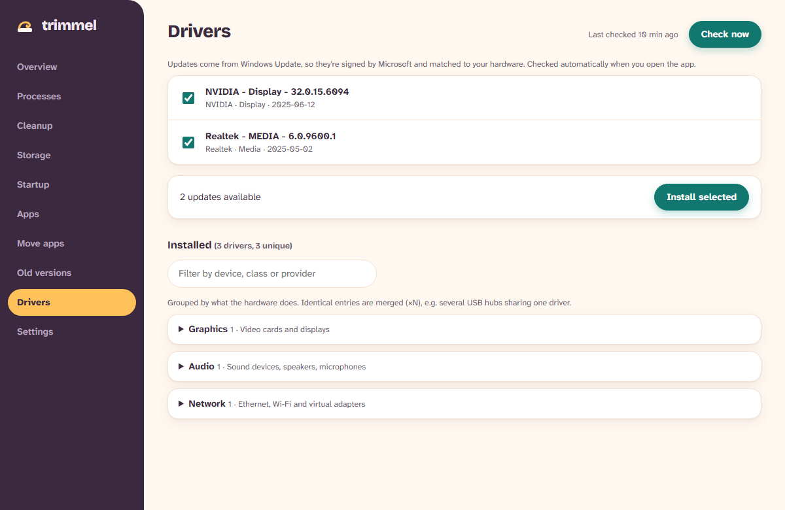
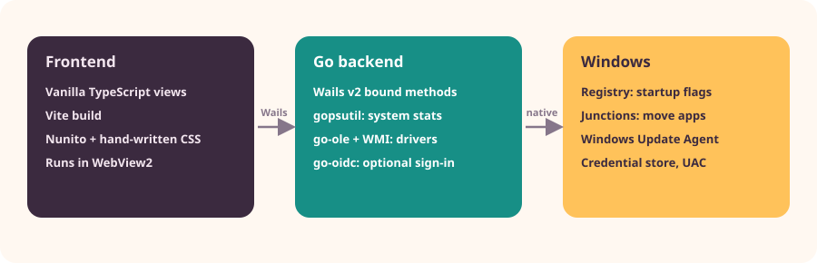

<p align="center">
  
</p>

<p align="center">
  
  
  
  
  
</p>

<p align="center">
  <b>Free up space. Trim slow startups. Keep drivers current.</b><br>
  One small desktop app, with plain-English explanations and nothing deleted behind your back.
</p>

---

## 👀 See it in action

No download needed. Here is how each main screen looks.

> These are illustrations drawn in the app's own palette, with sample data. Real screens match the layout and colours.

<table>
  <tr>
    <td width="50%"><br><sub><b>🏠 Overview</b>: your PC at a glance, with plain-English tips.</sub></td>
    <td width="50%"><br><sub><b>🧹 Cleanup</b>: see what each item takes up, tick what goes.</sub></td>
  </tr>
  <tr>
    <td width="50%"><br><sub><b>🚀 Startup</b>: switch slow launchers off. Fully reversible.</sub></td>
    <td width="50%"><br><sub><b>📦 Move apps</b>: shift big programs to another drive.</sub></td>
  </tr>
  <tr>
    <td colspan="2" align="center"><br><sub><b>🔧 Drivers</b>: signed updates straight from Windows Update.</sub></td>
  </tr>
</table>

## ✨ What it does

| Tool | What you get |
| --- | --- |
| **Overview** | A health score out of 100 with plain-English suggestions that jump to the right tab, plus CPU, memory, drives and uptime. Optional reminder to tidy up every week, fortnight or month. |
| **Processes** | Live CPU and memory per process, refreshed every 2 seconds, with a plain-English note on what each one belongs to. End a task in one click. Critical Windows processes are protected. |
| **Cleanup** | Scans temp folders, Windows Update downloads, Chrome, Edge and Firefox caches, crash dumps and the Recycle Bin. Shows what each takes up, then deletes only what you tick. Also graphics shader caches, Windows error reports and the Delivery Optimization cache. |
| **Storage** | Shows which folders and files take the most space on a drive, with drill-down and "Show in Explorer". Read-only: nothing is deleted from this page. |
| **Startup** | Lists everything that launches at sign-in, including scheduled tasks, with a rough impact rating and a plain-English note on each. Switch items off and on; it uses the same flag as Task Manager, so it is fully reversible. |
| **Apps** | Every installed program with size and install date. Uninstall opens the program's own uninstaller so you confirm what is removed. |
| **Move apps** | Moves a big program to another drive and leaves a link behind so it keeps working. Copies and verifies first, and can move it back. Cleans up leftovers from interrupted moves. |
| **Old versions** | Finds older duplicate installs and opens each program's own uninstaller, so you see and confirm what is removed. |
| **Drivers** | Lists installed drivers and checks Windows Update for newer ones. Installs the ones you pick. |

## 🧰 Tech stack

<p align="center">
  
</p>

| Layer | Tech | Why |
| --- | --- | --- |
| 🪟 **Shell** | [Wails v2](https://wails.io) | Small native `.exe` that hosts the UI in WebView2. No bundled browser. |
| ⚙️ **Backend** |  | Fast, one static binary, easy Windows API access. |
| 🎨 **Frontend** |   | Vanilla views, no framework. Typed bindings in `api.ts`. |
| 📊 **System stats** | [gopsutil](https://github.com/shirou/gopsutil) | CPU, memory, disks and per-process figures. |
| 🔌 **Windows** | [go-ole](https://github.com/go-ole/go-ole), [wmi](https://github.com/yusufpapurcu/wmi), `golang.org/x/sys` | Windows Update Agent, driver list, registry and junctions. |
| 🔐 **Sign-in** (optional) | [go-oidc](https://github.com/coreos/go-oidc), `oauth2`, [go-keyring](https://github.com/zalando/go-keyring) | OpenID Connect with PKCE. Refresh token kept in the Windows credential store. |
| 🔤 **Type** | [Nunito](https://fonts.google.com/specimen/Nunito) | Friendly, readable, bundled locally. |

## 🛡️ Safety first

Trimmel is built to be cautious. Tools that delete or change things follow these rules:

- **Cleanup** only removes files older than 24 hours in temp and update folders. It never follows symlinks or junctions and never removes the target folder itself. Locked files are skipped and counted. The Recycle Bin is opt-in.
- **Startup** writes a flag instead of deleting the entry. Switch it back on at any time, in the app or in Task Manager.
- **Move apps** copies, then checks file counts and sizes match, then swaps in a link. If anything looks wrong it restores the original. It refuses system folders, Store apps and running programs.
- **Drivers** come only from Windows Update, so they are signed and matched to your hardware. Updates with licence terms are skipped rather than accepted for you.
- **Processes**: system-critical processes and the app itself cannot be ended.
- **Old versions** never runs a command from the UI. The uninstaller is looked up by ID and must still be flagged as an older version.

## 🚀 Get started

### Prerequisites

- Windows 10 or 11 (WebView2 runtime is preinstalled)
- [Go](https://go.dev/dl/) 1.26+
- [Node.js](https://nodejs.org/) 18+
- Wails CLI: `go install github.com/wailsapp/wails/v2/cmd/wails@latest`

Run `wails doctor` to check everything is in place.

### Run it

```powershell
git clone https://github.com/<your-username>/pcoptimizer.git
cd pcoptimizer
go mod tidy
wails dev          # hot-reloading dev build
wails build        # release build -> build\bin\trimmel.exe
```

`frontend/dist` is not committed. `wails dev` and `wails build` create it. If you only want `go build` or `go test ./...` to compile the root package, run `npm install && npm run build` in `frontend` first.

### Build the installer

```powershell
.uild-installer.ps1     # -> installeruildin\Trimmel-Setup.exe
```

The installer is its own small Wails app in `installer/`, themed to match Trimmel. It embeds the built app, installs to Program Files, adds Start Menu and optional desktop shortcuts, and registers an uninstaller under **Settings > Apps**. Running the same file again updates in place. Bump `productVersion` in `wails.json` for each release.

### Admin rights

Trimmel asks for administrator rights at launch (a UAC prompt). It needs them for Windows temp and Windows Update cleanup, startup items for all users, driver installs, and moving apps out of Program Files. Standard accounts need an admin password to start it.

## 🔑 Sign in with Google

Users just click **Sign in with Google** the first time. After that the app remembers them, so there is nothing to configure. To make that work, the maintainer builds the Google credentials into the app once:

1. In [Google Cloud Console](https://console.cloud.google.com/apis/credentials), create an **OAuth client ID** of type **Desktop app**. On the consent screen, add only the `openid`, `email` and `profile` scopes, then set the publishing status to **In production** so anyone with a Google account can sign in.
2. Create a git-ignored file named `.env.local` next to `build-installer.ps1`:

   ```
   PCOPT_GOOGLE_CLIENT_ID=<client id>
   PCOPT_GOOGLE_CLIENT_SECRET=<client secret>
   ```

3. Run `.\build-installer.ps1`. The values are compiled into the app. Without a client ID the build has no sign-in and opens straight into the app.

Google issues a secret for desktop apps but does not treat it as confidential, because PKCE protects the flow. Still, keep it out of git.

It uses the authorization code flow with PKCE and a loopback redirect, verifies ID tokens, and stores only the refresh token in the Windows credential store. Other OpenID Connect providers work through `%APPDATA%\trimmel\auth.json` (`issuer`, `clientId`, optional `clientSecret`) or the `PCOPT_OIDC_ISSUER`, `PCOPT_OIDC_CLIENT_ID` and `PCOPT_OIDC_CLIENT_SECRET` environment variables.

> Sign-in is a convenience gate, not a security boundary against someone with access to your user account.

## 🗂️ Project layout

```
app.go                   methods bound to the frontend (window.go.main.App.*)
internal/overview        system snapshot (gopsutil)
internal/procs           process monitor; keeps handles so CPU % is a live delta
internal/cleanup         targets + scan/delete walker (with tests)
internal/startup         Run keys, Startup folders, StartupApproved flags
internal/drivers         WMI driver list, Windows Update Agent via go-ole
internal/mover           move installs between drives via junctions, leftovers
internal/oldver          older duplicate installs and their uninstallers
internal/auth            OpenID Connect sign-in (PKCE, loopback redirect)
internal/elevation       IsElevated check
installer/                custom themed setup app (embeds the built app)
frontend/src             vanilla TypeScript views, typed bindings in api.ts
```

Each Windows-specific package has an `_other.go` stub, so `go vet` and `go test` also run on macOS and Linux.

## ✅ Tests

```powershell
go test ./...
```

## 🎨 Design

Warm and friendly on purpose. Plum sidebar, teal actions, honey highlights, [Nunito](https://fonts.google.com/specimen/Nunito) type, soft rounded shapes and gentle screen transitions. Motion respects the system **reduce motion** setting.

| | Colour | Used for |
| --- | --- | --- |
|  | `#3b2a3f` plum | Sidebar, toasts |
|  | `#178f86` teal | Primary actions, bars |
|  | `#ffc25a` honey | Active tab, highlights |
|  | `#fff8f1` cream | Background |

## 🤝 Contributing

Issues and pull requests are welcome. Please run `go test ./...` and `npm run build` in `frontend` before opening a PR, and keep new tools in line with the safety rules above: preview first, reversible where possible, never delete without a clear choice.

## 📄 License

[MIT](LICENSE). Third-party notices, including the bundled Nunito font, are in [THIRD_PARTY_NOTICES.md](THIRD_PARTY_NOTICES.md).

---

<p align="center">Trimmel</p>
